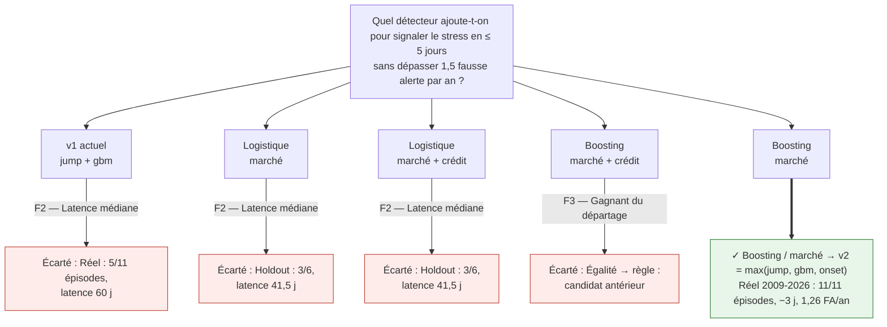
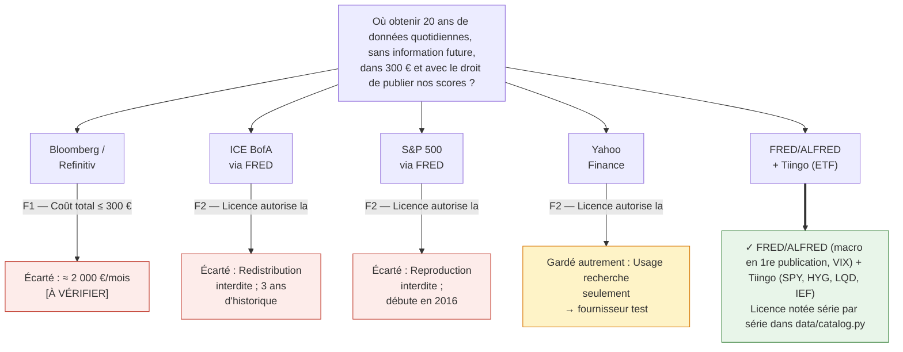
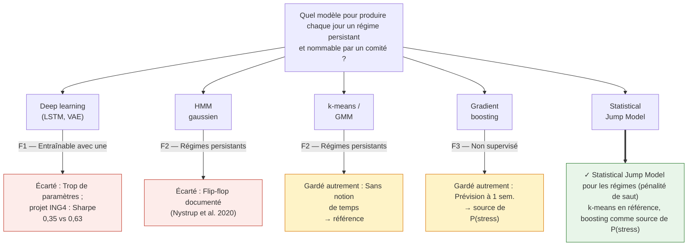
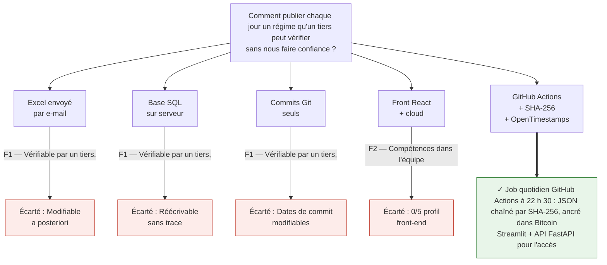
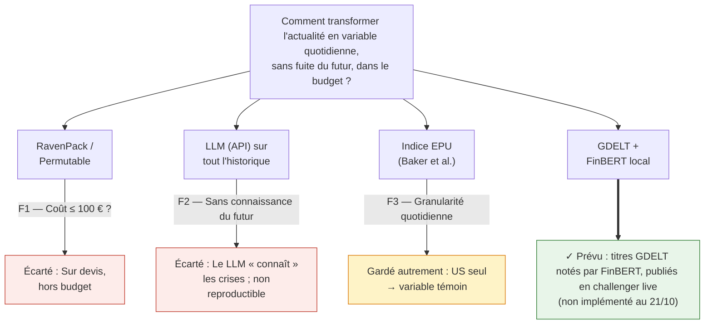

# Arbres de choix — version éditable (Mermaid)

Généré depuis `_build/content.py`. Collez un bloc dans Notion, GitHub ou [mermaid.live](https://mermaid.live) pour le modifier.

## Arbre n°1 — Détecteur de début de stress (protocole pré-enregistré)

Filtres :

- F1 — Holdout 1999-2009 : ≤ 1,5 FA/an et ≤ 10 % des jours calmes ?
- F2 — Latence médiane (tous épisodes) ≤ 5 j ?
- F3 — Gagnant du départage pré-enregistré ?

**Synthèse.** Décision (01/10/2026, pré-enregistrée avant tout calcul sur données réelles) : le détecteur gradient boosting sur données de marché est ajouté au modèle. Sur les 11 épisodes réels hors échantillon, il les détecte tous, avec une latence médiane de −3 jours et 1,26 fausse alerte par an. Compromis assumé : les fausses alertes passent de 0,17 à 1,26 par an, proches de la limite, et les changements de régime de 3,4 à 5,6 par an. Limite : ces épisodes avaient déjà été vus ; seul le track record live est un test en aveugle.

## Arbre n°2 — Sources de données

Filtres :

- F1 — Coût total ≤ 300 € sur le projet ?
- F2 — Licence autorise la publication de scores dérivés ?
- F3 — Historique ≥ 2004 et première publication ?

**Synthèse.** Décision : FRED/ALFRED pour la macro (chaque chiffre lu dans sa première publication, daté du jour de sa sortie) et Tiingo pour les prix d'ETF. Compromis assumé : les ETF remplacent les indices sous licence, et avant 2007 le crédit investment grade (LQD/IEF) remplace le high yield (HYG). Limite : l'offre gratuite de Tiingo couvre la recherche ; un usage commercial demanderait une offre payante.

## Arbre n°3 — Modèle des régimes

Filtres :

- F1 — Entraînable avec une dizaine de crises ?
- F2 — Régimes persistants (pas de « flip-flop ») ?
- F3 — Non supervisé (pas d'étiquettes arbitraires) ?

**Synthèse.** Décision : le Statistical Jump Model nomme les régimes ; chaque état prend le nom du régime de la règle dont il est le plus proche, sans réglage à la main. Compromis assumé : la persistance peut retarder un changement, d'où le détecteur de stress séparé (arbre n°1).

## Arbre n°4 — Publication et preuve

Filtres :

- F1 — Vérifiable par un tiers, impossible à antidater ?
- F2 — Compétences dans l'équipe (0 profil front-end) ?
- F3 — Coût ≤ 50 € sur le projet ?

**Synthèse.** Décision : chaque jour ouvré, un job publie un fichier JSON chaîné à la veille par son empreinte SHA-256 et horodaté via OpenTimestamps dans Bitcoin. Un jour ne peut être ni modifié, ni supprimé, ni antidaté sans que cela se voie. État au 20/10 : 14 jours publiés, 13 déjà ancrés.

## Annexe — Arbre prévu pour la Phase 3 : actualité

Filtres :

- F1 — Coût ≤ 100 € ?
- F2 — Sans connaissance du futur (modèle figé, reproductible) ?
- F3 — Granularité quotidienne depuis 2015 ?

**Synthèse.** Prévu pour la Phase 3 : FinBERT exécuté localement sur les titres GDELT, ajouté comme challenger publié en live. Comme les crises passées ont déjà été vues, seul le live peut dire si l'actualité accélère la détection.
